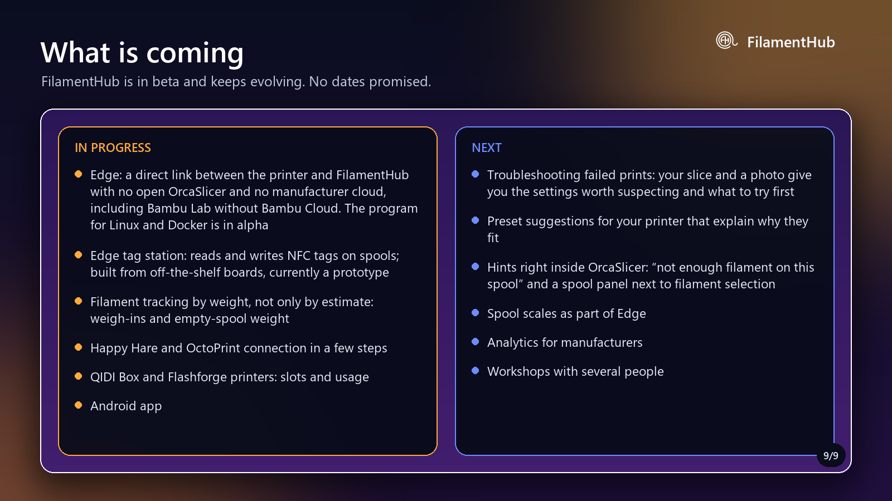

FilamentHub connects materials, print settings, your spools and printers. Find a filament and a suitable profile, bring the settings into OrcaSlicer, keep track of your stock and calculate what a print costs.

> **OrcaSlicer will ask for permission.** When the plugin loads, OrcaSlicer asks whether it may run work in the background. Answer "Yes": syncing and loading presets run in the background so the slicer does not freeze. OrcaSlicer remembers the answer; with "No" it does not load the plugin.

## Why it is useful

**If you print**

- **Find the right settings.** Search the catalogue by brand, type, colour, property or your printer. Presets are official, from the community, or your own; a generative preset combines the community's presets for a filament into one, with the temperature people actually print at.
- **Know your spools.** Remaining weight, price, batch, usage history, and the printer slot a spool sits in. Bring your stock over from a spreadsheet or an OctoPrint SpoolManager export.
- **QR labels.** Scan the maker's QR code on a spool, or print a label with the spool's own QR. A phone scan opens the spool.
- **Usage tracked automatically** while OrcaSlicer is open: Bambu Lab, Klipper with Moonraker and Happy Hare, QIDI, Snapmaker U1, Creality, Flashforge. Anycubic, Elegoo and Prusa count no filament themselves, so they are charged OrcaSlicer's estimate of the job. Every estimate is marked as one.
- **From G-code to a quotation.** Reuse an OrcaSlicer slice to calculate the cost per filament, check that each spool has enough left, prepare a customer quotation and continue accepted work as an order.

**If you make filament**

- A brand page with your materials, official presets for them, and QR codes on spools that lead to the material and its profile.

## What the plugin does inside OrcaSlicer

The plugin adds a **FilamentHub** tab and keeps the slicer and your account in step.

- **Presets in the normal filament list**, with their colour and inheritance. On OrcaSlicer 2.5 and later a new or updated preset appears at once; older builds need a restart.
- **Edit presets the way Orca groups them**: familiar tabs and Simple, Advanced or Expert detail.
- **Automatic sync.** With **Sync automatically** on, saving a filament or process preset syncs it to FilamentHub without holding OrcaSlicer up. **FilamentHub Sync** in Speed Dial starts a full sync.
- **Your look**: the FilamentHub appearance, or OrcaSlicer's light or dark colours.

The toolbar: **My Spools**, **Catalog**, **Profile** (presets, printers, calculations, quotations, orders), **Wiki** (short guides), **Sync** (selected presets), and **Recover**, which finds your existing OrcaSlicer presets on this computer, across accounts and backups, and imports only what you tick. Nothing in OrcaSlicer is overwritten.

Settings are in OrcaSlicer's plugin manager: server, appearance, automatic sync, notifications and developer mode. The optional Slicing Pipeline reporter brings completed slices into FilamentHub for cost calculations and quotations.

## What is coming

FilamentHub is in beta. What is in progress and what comes next, without dates, is on the [About page](https://filamenthub.ru/about) and in the picture below. The catalogue, presets and basic tracking of your own spools are free, and they will stay free.

## Your data and your computer

- **Your presets.** FilamentHub manages only the preset copies it creates. System, project, third-party and other user presets are left untouched.
- **Who it talks to.** The FilamentHub site and API (filamenthub.ru, or filamenthub.club if you choose that server) and the printers you set up. No other services.
- **Printers, only after you set them up**, at the address in your printer profile, over your local network:
  - Bambu Lab: status over MQTT and the file being printed over FTPS, read-only. The only thing written is an AMS slot's material, when you apply a spool assignment.
  - Klipper with Moonraker: the print state every 30 seconds during a print and every two minutes otherwise, and its configuration only to see whether `[spoolman]` points at FilamentHub. For Happy Hare, one command refreshes its spool list, only when you ask.
  - Creality, Anycubic (LAN mode), Prusa (PrusaLink) and Elegoo (SDCP or MQTT): state and slots are read, and no commands are sent. Anycubic's LAN login is fetched from the printer on port 18910, used for its MQTT connection on port 9883 and kept only in memory.
  - For Anycubic, Elegoo and Prusa the plugin keeps a copy of the newest few G-code files OrcaSlicer writes, in its own storage folder, to find a job's estimate.
  - Searching for printers on the network runs only when you press search or start printer setup. It asks the system for the computer name only to list your network adapters; the name is not stored or sent.
- **Keys and passwords.** Printer access codes, API keys and print-host passwords stay on your computer: they are removed before a printer profile is uploaded. A Bambu access code and a Moonraker key are kept in the plugin's storage folder, restricted to your user account where the system supports it. Printer addresses are synced to your account only if you turn on **Store printer addresses in FilamentHub**.
- **Slices.** Slice reporting is optional. FilamentHub receives the slice details needed for history and calculations, never the full G-code. With the FilamentHub slicing step chosen, the plugin adds comment lines with profile identifiers to the end of the G-code.
- **Diagnostics.** The log stays on your computer. **Report a problem** can attach its end with version details; you see it first, your home folder name is replaced and keys are masked. Nothing is sent automatically.
- **At start-up** the plugin reads its settings and preset files and, if you already linked a printer, reads it again and sends its usage to FilamentHub. It does not open a browser or scan the network.
- **What it opens and writes.** The browser opens only when you click a link or sign in. The plugin starts no other programs and writes only to its own storage folder and its FilamentHub preset folder. Quotations print from the FilamentHub tab (use Print and Save as PDF).
- **Permissions.** The plugin declares what it needs when it loads, so you answer once. OrcaSlicer still asks the first time anything else is needed, such as a new network address.

## Requirements

- A FilamentHub account.
- An OrcaSlicer build with Python plugin support.
- Windows or Linux. macOS installs but has not been tested yet; if presets do not appear on a Mac, turn on developer mode and send **Report a problem** from the FilamentHub tab.
- Local-network access to your printer for printer features.
